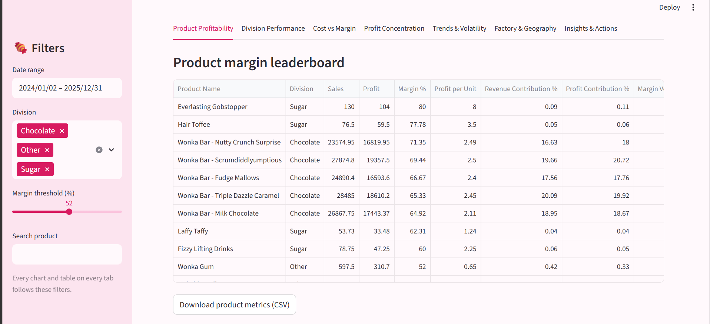
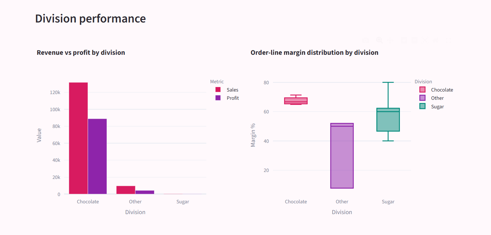
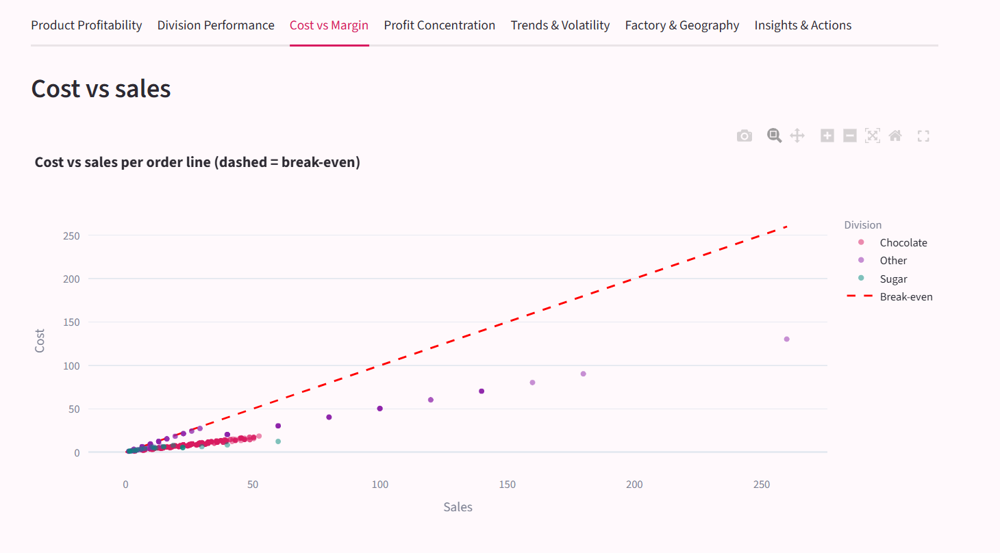

# Nassau Candy Profit Lab

Product line profitability and margin performance analysis for Nassau Candy Distributor
(Unified Mentor project). It answers one question: which products and divisions actually make money?

**Live dashboard:** 

## Key findings
- 10,194 order lines, Jan 2024 to Dec 2025. Sales 141,784, gross profit 93,443, margin 65.9%.
- 5 of 15 products (all Wonka Bars) give 92.9% of sales and 95.1% of profit, made in just two factories.
- Kazookles sells at 3.25 and costs 3.00 per unit, a 7.7% margin. It pulls the Other division down to 44.8% (50.1% without it).
- Unit prices and costs are fixed, so margin does not vary over time, region or ship mode. Pricing and product choice are what matter.
- Ship Date in the dataset is invalid (900+ days after order) and was not used.

## Dashboard
Sidebar controls (apply to every tab): date range, division, margin threshold slider, product search.

| Tab | What it shows |
|---|---|
| Product Profitability | margin leaderboard, profit contribution, sales vs margin quadrant |
| Division Performance | revenue vs profit, margin distribution, revenue share vs profit share |
| Cost vs Margin | cost vs sales scatter, risk flags, repricing table, price what-if |
| Profit Concentration | Pareto chart and dependency indicators |
| Trends & Volatility | monthly performance, margin volatility |
| Factory & Geography | factory margin, region x division heatmap, top states, ship mode |
| Insights & Actions | live insights and a downloadable action list |

## Run locally
```
pip install -r requirements.txt
python analysis.py        # cleans the data, writes outputs/ and charts/
streamlit run app.py      # opens the dashboard
```

## Project structure
```
common.py       cleaning and metric functions
analysis.py     full analysis, tables and charts for the report
app.py          Streamlit dashboard
data/           raw dataset
outputs/        cleaning log, key findings, metric tables
charts/         charts used in the report
report/         report draft
```

## Method in short
Gross margin = total profit / total sales (weighted). Profit per unit, revenue and profit contribution,
and margin volatility (std of monthly margin) are calculated per product. Risk flags: margin below the
threshold (default 50%) and revenue share below 1% means discontinuation review; margin below the
threshold otherwise means reprice or renegotiate cost.

## Screenshots (few samples)




## Author
Neha Malhotra, Unified Mentor Machine Learning Internship